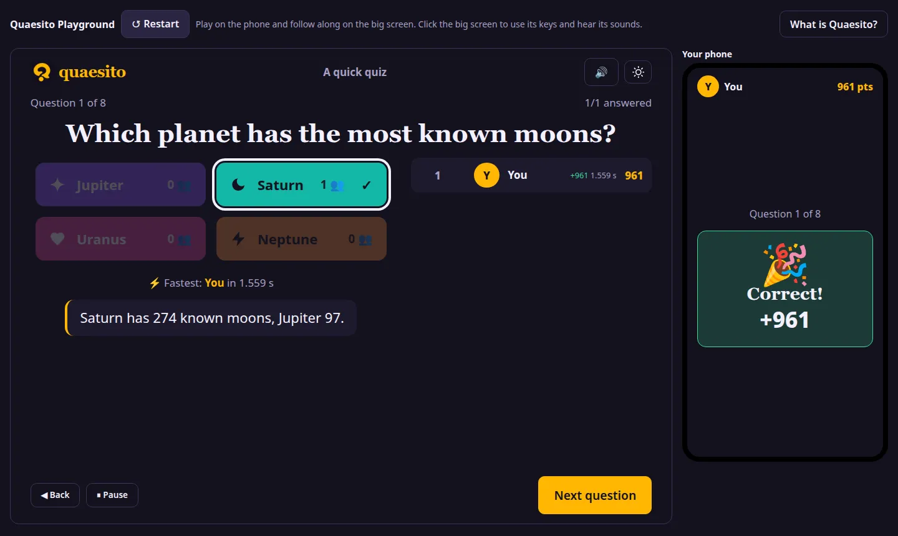

<h1 align="center">
  <picture>
    <source media="(prefers-color-scheme: dark)" srcset="assets/brand/logo-dark.png">
    
  </picture>
</h1>

<p align="center"><b>Quizzes among friends.</b> A pub quiz in your living room: the questions on the TV,<br>
every team answering on a phone, and the whole thing running on your own laptop.</p>

<p align="center">
  🎮 <a href="https://ggirelli.github.io/quaesito/playground/"><b>Try it in your browser</b></a> ·
  ⬇️ <a href="https://github.com/ggirelli/quaesito/releases/latest"><b>Download</b></a> ·
  📖 <a href="https://ggirelli.github.io/quaesito/"><b>Documentation</b></a>
</p>

<p align="center">
  <a href="https://ggirelli.github.io/quaesito/playground/">
    
  </a>
</p>

## Try it in your browser

The [Playground](https://ggirelli.github.io/quaesito/playground/) is a short quiz you can play right
now, with nothing to install: the big screen and a pretend phone sit side by side on one page. Answer
on the phone and watch the big screen run the clock, reveal the answer and keep the score, up to the
podium. It runs Quaesito's own game engine and screens entirely in your browser. No game server is
involved, and your answers stay on your device.

It is a taste, not the whole thing: one team, eight questions, no pictures or music. The real app
adds everything below.

## Made for game nights

- **No app, no accounts, no internet.** Teams join by scanning a QR code on the big screen, from any
  phone on your Wi-Fi.
- **[Eight kinds of questions](https://ggirelli.github.io/quaesito/question-types/):** multiple
  choice, true or false, typed answers you judge on the big screen, number guesses, putting things in
  order, several answers in one, matching pairs, and pins on a picture.
- **A [library of about 2,700 questions](https://ggirelli.github.io/quaesito/question-library/)** to
  pick from, or to fill a quiz at random.
- **A quiz editor in the browser** that saves as you type, with pictures, videos, soundtracks and
  slides between rounds, and a **test mode** to play it with pretend phones before the night.
- **The drama of a real quiz show:** a clock with music, pictures revealed tile by tile, reveals with
  the fastest team and who moved up, jokers and double-points questions, and a podium with a fanfare.
- **Made for real life:** pause, extra time, going back, and games that survive a crash or restart.
- **Up to 50 teams by default**, which the host can raise to at most 10,000 when starting a game, with
  any number of players each. That is a cap, not a tested size: your network sets the real limit.
- **Yours:** self-hosted, with your quizzes and pictures kept in a folder on your computer. Results
  print or download as CSV, and quizzes export with their pictures to share.

> [!IMPORTANT]
> - **Free and open source** under the [MIT licence](LICENSE), provided as is, **without warranty**.
> - **Fully vibe coded:** an AI assistant (Claude) wrote all of its code, tests and docs. Read the
>   [disclaimer](DISCLAIMER.md) before relying on it.
> - **Donations are welcome** on [GitHub Sponsors](https://github.com/sponsors/ggirelli) or
>   [Ko-fi](https://ko-fi.com/ggirelli).

## How a game goes

1. **Build** a quiz in the browser, or start from the library. **Test** it on your own with pretend
   phones.
2. **Show** the big screen on a TV or projector. Teams scan its QR code and pick a name and a
   picture.
3. **Play:** teams answer against the clock, the big screen reveals answers and standings, and a
   podium crowns the winner.

Each quiz sets its own [scoring, reveals and pace](https://ggirelli.github.io/quaesito/quiz-settings/).

## Get started

1. Download the archive for your system (Windows, macOS on Apple silicon or Intel, Linux on x86-64 or
   ARM64) from the [latest release](https://github.com/ggirelli/quaesito/releases/latest) and unpack it.
2. Double-click `start.bat` (Windows) or `start.command` (macOS), or run `./start.sh` (Linux).
3. Your browser opens Quaesito. Log in with the admin password shown in the server window, and try the
   **Demo quiz**.

The [getting started guide](https://ggirelli.github.io/quaesito/getting-started/) covers the details, and
the user guide also ships with the app (**Help** in the admin pages). To let teams join from anywhere,
run it on a small Linux server (x86-64 or ARM64) behind HTTPS: see
[hosting on the internet](https://ggirelli.github.io/quaesito/deployment/).

## Development

Quaesito is written in Rust with [Dioxus](https://dioxuslabs.com): one program serves the big screen
and the phones and keeps the games' state. It is a Cargo workspace:

- **`quaesito-core`** (`crates/core`): the rules (quizzes, scoring, the game engine), with no server,
  files or network, so it is fully unit tested and also builds for the browser.
- **`quaesito-server`** (`crates/server`): storage, admin sign-in, live sessions and HTTP routes.
- **`quaesito`** (the root, `src/`): the app and its screens.
- **`quaesito-playground`** (`crates/playground`): the Playground, the same engine and screens with no
  server, published with the docs.

You need Rust (stable) with the `wasm32-unknown-unknown` target,
[`dx`](https://dioxuslabs.com/learn/0.7/getting_started) (the Dioxus CLI, 0.7.10),
[`just`](https://github.com/casey/just), [`cargo-deny`](https://github.com/EmbarkStudios/cargo-deny)
and [`uv`](https://docs.astral.sh/uv/) (for the user guide, which `just serve` builds).

```sh
just serve              # hot-reloading dev server on the LAN (admin password "quaesito")
just play               # release build served on the LAN, for real games
just check              # fmt, clippy, rustdoc, tests and cargo-deny, as in CI
just docs               # the user guide, live at http://127.0.0.1:8000
just playground-serve   # the Playground, at http://127.0.0.1:8094/quaesito/playground/
```

`just` on its own lists every recipe. More in the
[development guide](https://ggirelli.github.io/quaesito/development/) and
[how it works](https://ggirelli.github.io/quaesito/architecture/).

## Contributing

Bug reports, ideas and pull requests are welcome: see [CONTRIBUTING.md](CONTRIBUTING.md) and the
[code of conduct](CODE_OF_CONDUCT.md). Report security problems privately as described in
[SECURITY.md](SECURITY.md). Changes are listed in [CHANGELOG.md](CHANGELOG.md).

## Licence

[MIT](LICENSE)
