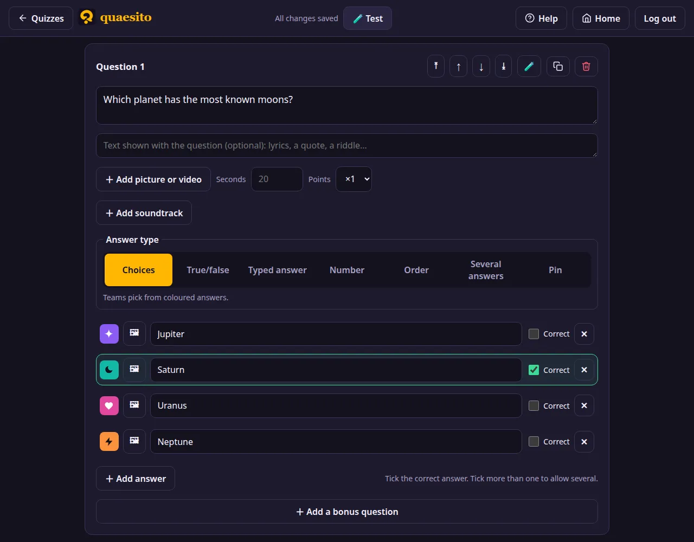
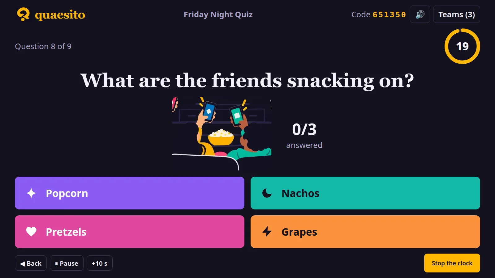
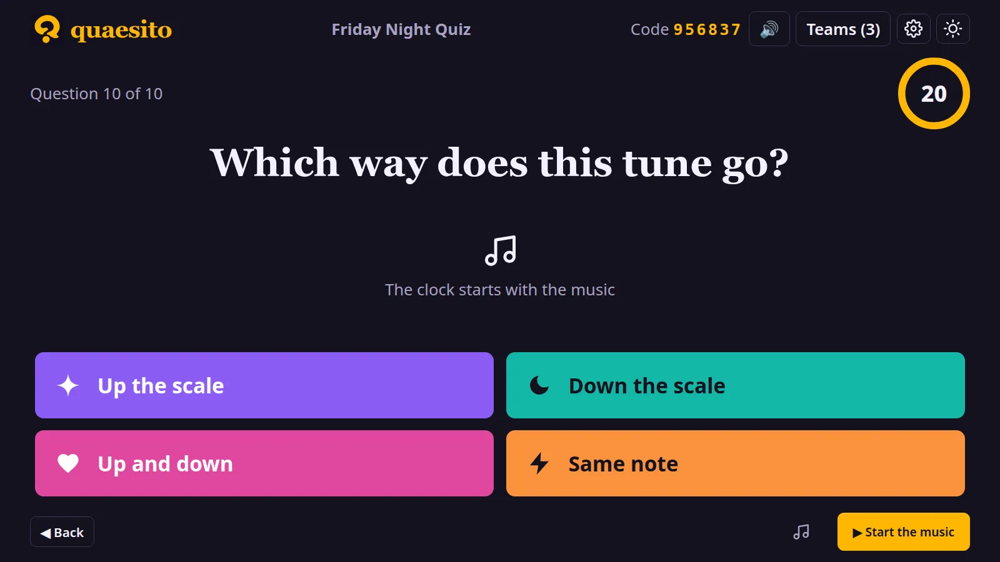
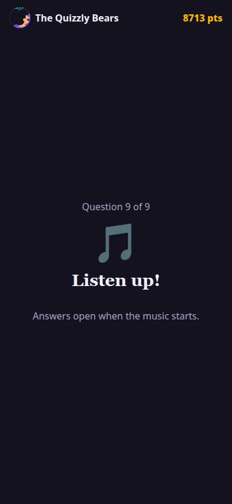

# Building a quiz

On the admin page, press :material-file-plus-outline: **New quiz**, type a title and press
**Create quiz**. The editor saves as you type and says when the quiz is ready to play, or what is
still missing. The quiz list flags quizzes that are not ready yet; search it by title, and sort it
by last edit, newest, name or number of questions.

## Questions and slides

- **Add** questions with **＋ Add question**, and slides with **＋ Add slide**: a title, some text
  and a picture to introduce a round or explain the rules.
- **Results slides** (with **＋ Add results slide**, when answers are revealed at the end) give
  the results halfway, at an intermission say: they walk through the answers to the questions
  since the previous results slide, then show the standings with the points each team gained.
  The review at the end then only covers the questions after the last results slide.
- **Move** an item with ↑ ↓, or straight to the top or bottom with ⤒ ⤓. Duplicate it or delete
  it with the icons next to them.
- **Shuffle** with :material-shuffle: **Shuffle questions**: questions are shuffled within each
  round, slides stay where they are, and you can undo it until you change something else.
  :material-shuffle: **Shuffle answers** does the same for the answers of every multiple-choice
  question; the right answers stay right.

Each question has an **answer type** (see [question types](question-types.md)), a time limit
(the quiz's default unless you set one) and a **points** multiplier: a ×2 question earns twice
the usual points.

## The question library

Quaesito comes with a library of about 2,700 ready-made questions in 14 categories, from art to
technology, each rated easy, medium or hard. They were written with an AI model and fact-checked,
but read the ones you pick before playing: a few may still be wrong or out of date.

- **Browse it** on the admin page's **Questions** tab. Pick a category on the left to see only its
  questions; it opens onto its topics, which narrow the list further. Pick the category again to
  close it. Search questions and answers, and filter by difficulty and answer type.
- **In the editor**, press **＋ From the library** to browse it the same way. **＋ Add** adds one
  question at the end of the quiz; 🎲 **Add at random** adds as many of the questions shown as
  you ask for. Questions already in the quiz are marked, and never added twice at random.
- **For a whole quiz**, tick **Fill it with random questions from the library** when creating it,
  tick the categories you want and say how many questions each gets (5 by default). You can keep
  to one difficulty, and open each category with a title slide.

Answers that change over the years (records, title holders) say "As of" a year, and are marked
*may date*: **Leave out answers that may date** skips them. Once added, a question is yours like
any other: edit it, add a picture, or change its time limit and points.

## Text with the question

Under the question, an optional box takes text to show with it, line breaks kept: the lyrics for
"name the song", a quote for "who said it?", a riddle. The big screen shows it under the question,
and so do phones when they show the full question.

## Pictures

Add a picture to any question. For a guessing game, choose how it appears while the clock runs:

- **Show it all**, as it is;
- **Zoom out from a close-up**: it starts five times larger and widens to the whole picture;
- **Uncover tile by tile**: tiles drop away at an even pace.

With a gradual reveal, set how many seconds the whole picture stays visible before the buzzer.
Pictures are resized and re-encoded when uploaded, up to 15 MB.

## Videos

Instead of a picture, a question or a slide can show a video (MP4 with H.264, WebM or MOV, up to
200 MB). It plays on the big screen when the question opens, pauses when you pause the game, and
plays again from the start when you click it. Pin questions need a picture.

The upload limits can be changed; see [configuration](configuration.md).

## Soundtracks

A question can have a soundtrack (MP3, M4A/AAC, Ogg/Opus, WebM, FLAC or WAV, up to 40 MB). The
question then waits on the big screen with a full clock until you press **▶ Start the music**:
the music plays from the big screen and the countdown starts with it. **Stop the clock** stops the
music too; when time runs out instead, it plays on while the answers are shown.

<figure markdown>

<figcaption>The question waits, with a full clock, for the music.</figcaption>
</figure>
<figure markdown>

<figcaption>Phones listen until the music starts.</figcaption>
</figure>

## Import and export

The export icon on the admin page downloads a quiz as a `.zip` with its pictures and
soundtracks. **Import** on another computer brings it back as a new quiz; older `.json` exports
import too. A bar above the list follows big quizzes as they upload, as their pictures and
soundtracks are processed, and as exports download. A quiz made with a newer version of Quaesito asks first, and says what this version
would leave out. The [quiz file format](quiz-file-format.md) page describes what is inside, to write
or generate quizzes yourself.
