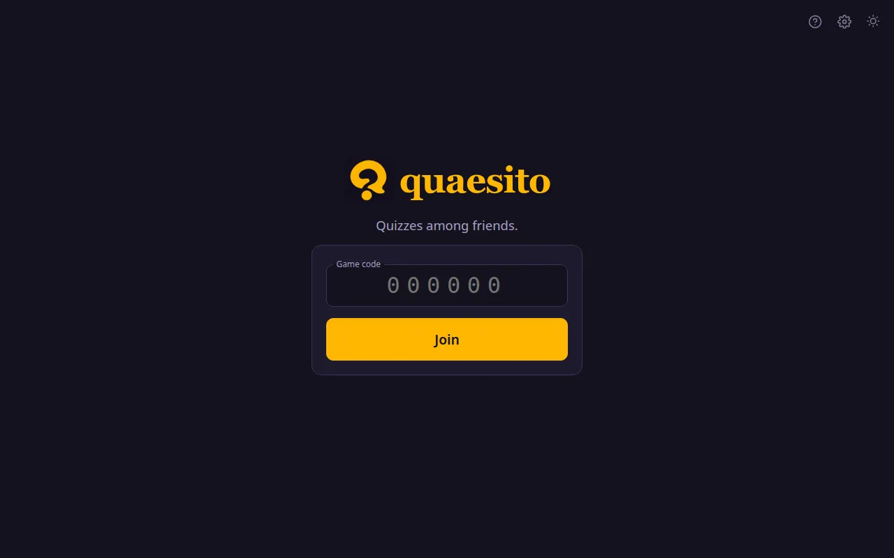
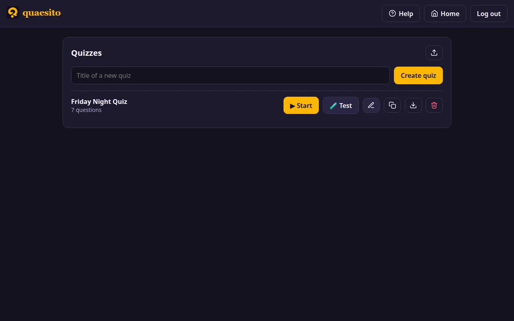

# Getting started

Quaesito runs on one computer, usually the laptop connected to the TV. Everyone else joins from
their phones over the same Wi-Fi; no internet connection is needed.

## Quick start

1. **Pick the download** for the computer that will run quaesito (see
   [which download](#which-download)).
2. **Download and unpack it** from the
   [latest release](https://github.com/ggirelli/quaesito/releases/latest), under **Assets**.
3. **Start it:** double-click `start.bat` (Windows) or `start.command` (macOS), or run
   `./start.sh` (Linux). Allow it through the firewall if asked: that is what lets phones connect.
4. **Log in:** your browser opens quaesito. Click the :material-cog: icon and type the admin
   password shown in the server window.
5. **Pick a quiz:** try the **Demo quiz** with **🧪 Test**, or press **New quiz** to
   [build your own](building-a-quiz.md), perhaps from the [question library](question-library.md).
6. **Start the game:** press **▶ Start** next to the quiz, and show the big screen on the TV.
7. **Teams join:** each team scans the QR code with a phone on the same Wi-Fi, and picks a name
   and a picture. Then [run the game](running-the-game.md).
8. **Something wrong?** See [troubleshooting](troubleshooting.md).

The rest of this page goes through each step in detail.

!!! info "Words used in this guide"
    - **Host:** the person running the quiz, on the computer quaesito runs on.
    - **Big screen:** the page shown on the TV or projector, with the questions and standings.
    - **Team:** one or more players answering from **one phone**.
    - **Quiz:** questions and slides you build and keep; a **game** is one playing of a quiz.
    - **Admin page:** where the host builds quizzes and starts games, behind the admin password.

## What you need

- A computer to run quaesito, with a web browser. It does not need anything else installed.
- A TV or projector for the big screen (optional: a laptop screen works for a small group).
- One phone per team, with a web browser, on the **same Wi-Fi network** as the computer. No app
  and no account are needed.

## Which download

| Computer | Download | Notes |
|---|---|---|
| Windows PC, 64-bit Intel or AMD | `quaesito-…-windows-x86_64.zip` | |
| Windows on Arm (such as Snapdragon laptops) | `quaesito-…-windows-x86_64.zip` | runs under Windows' built-in x64 emulation |
| Mac with Apple silicon (M1 and later) | `quaesito-…-macos-arm64.tar.gz` | |
| Mac with an Intel processor | `quaesito-…-macos-x86_64.tar.gz` | |
| Linux PC, 64-bit Intel or AMD (`uname -m` says `x86_64`) | `quaesito-…-linux-x86_64.tar.gz` | built on Ubuntu 22.04: needs glibc 2.35 or later |
| Linux, 64-bit ARM (`uname -m` says `aarch64`) | `quaesito-…-linux-arm64.tar.gz` | built on Ubuntu 22.04: needs glibc 2.35 or later |

There is no build for 32-bit systems. To find out which Mac you have, open the
Apple menu → **About This Mac**: **Chip** means Apple silicon, **Processor** means Intel.

## 1. Download and start it

=== "Windows"

    1. Download **`quaesito-…-windows-x86_64.zip`**.
    2. In your Downloads folder, right-click the zip and choose **Extract All…**, then
       **Extract**. Put the folder wherever you like, say on the Desktop.
    3. Open the folder and double-click **`start.bat`**.
    4. If a blue **"Windows protected your PC"** box appears (quaesito is not signed by a
       paying publisher), click **More info**, then **Run anyway**.
    5. When Windows asks whether to let quaesito through the firewall, tick **Private
       networks** and click **Allow**: this is what lets phones connect.

    A black window opens with the server's log, and your browser opens quaesito. Leave the window
    open while you play; close it to stop.

=== "macOS"

    `macos-arm64` is for Macs with Apple silicon (M1 and later), `macos-x86_64` for Intel Macs.

    1. Download **`quaesito-…-macos-arm64.tar.gz`** (or **`…-macos-x86_64.tar.gz`**). Safari unpacks it by itself; otherwise
       double-click it in your Downloads folder.
    2. Open the **`quaesito-…`** folder and double-click **`start.command`**.
    3. The first time, macOS says it **cannot verify** the app, because it is not signed by a
       paying developer. Click **Done** (or **Cancel**).
    4. Open **System Settings → Privacy & Security**, scroll down to the message about
       `start.command`, and click **Open Anyway**. Double-click `start.command` again and
       confirm with **Open Anyway** (and your password or Touch ID). On macOS 14 and earlier,
       right-clicking `start.command` and choosing **Open**, then **Open** again, does the same.
    5. If macOS asks whether to accept incoming network connections, click **Allow**: this is
       what lets phones connect.

    A Terminal window opens with the server's log, and your browser opens quaesito. Leave the
    window open while you play; close it to stop. Next time, a double-click is enough.

=== "Linux"

    For 64-bit PCs: `linux-x86_64` for Intel and AMD processors, `linux-arm64` for ARM ones
    (`uname -m` tells which).

    1. Download **`quaesito-…-linux-x86_64.tar.gz`** (or **`…-linux-arm64.tar.gz`**).
    2. Unpack it and start it from a terminal:

        ```sh
        tar xzf quaesito-*-linux-x86_64.tar.gz
        cd quaesito-*-linux-x86_64
        ./start.sh
        ```

    3. If your computer runs a firewall, let phones reach port 8080, for example with
       `sudo ufw allow 8080/tcp`.

    The terminal shows the server's log, and your browser opens quaesito. Leave it running while
    you play; press ++ctrl+c++ to stop.

The server window shows where quaesito is and the admin password:

```text
────────────────────────────────────────────────────────────────────────
  quaesito is running

  On this computer:  http://localhost:8080
  Phones join at:    http://192.168.1.20:8080
  Admin password:    3f9c1a7b2e44   (set QUAESITO_ADMIN_PASSWORD to choose your own)
────────────────────────────────────────────────────────────────────────
```

!!! tip "The browser did not open?"
    Open **<http://localhost:8080>** yourself, on the computer running quaesito. If that does not
    load either, see [troubleshooting](troubleshooting.md#quaesito-does-not-start).

## 2. Log in as admin



Click the :material-cog: icon in the top right corner and type the admin password from the server
window. A new password is made at every start unless you choose your own (see
[configuration](configuration.md)). A login lasts 12 hours: the big screen uses it too, so log in
on the computer that runs it shortly before the game.

## 3. Try the demo quiz



Your quiz list starts with a **Demo quiz** holding one question of each kind. Press
**🧪 Test** to play it with pretend phones next to the big screen (see
[testing a quiz](testing.md)), or open it to see how it is made. Delete it when you no longer
need it; it does not come back.

## 4. Play with friends

Press **▶ Start** next to a quiz and put the big screen on the TV. Friends join by scanning its
QR code with phones **on the same Wi-Fi as the computer**: see [running the game](running-the-game.md).
If phones cannot connect, see [troubleshooting](troubleshooting.md#phones-cannot-connect).

This guide comes with the app too: the :material-help-circle-outline: icon on the home page and
**Help** in the admin pages open it, even without an internet connection. That copy matches the
version you downloaded; this website follows the latest development version, so it may describe
features not released yet.

## Your data

Your quizzes, pictures and games are kept in the `data` folder next to the start script. Copy it
to back up or move everything to another computer.

**Updating to a new version:** unpack the new download into a new folder and, before starting
it, copy the `data` folder from the old folder into the new one. Otherwise the new version starts
with an empty `data` folder of its own, and your quizzes seem to be gone (they are still in the
old folder). Check the
[changelog](https://github.com/ggirelli/quaesito/blob/main/CHANGELOG.md) for what changed.

Next: [build your first quiz](building-a-quiz.md).
