---
hide:
  - navigation
  - toc
---

# Quizzes among friends

Put the questions on the TV, and let every team answer on a phone. Quaesito runs on your laptop,
works without internet, and needs no accounts or app installs.

[Download](https://github.com/ggirelli/quaesito/releases/latest){ .md-button .md-button--primary }
[Read the guide](getting-started.md){ .md-button }

Windows, macOS and Linux. Free and open source (MIT).

!!! info "Free, open source and vibe coded"
    - **Free and open source** under the
      [MIT licence](https://github.com/ggirelli/quaesito/blob/main/LICENSE), provided as is,
      **without warranty**.
    - **Fully vibe coded:** an AI assistant (Claude) wrote all of its code, tests and docs; see
      [how it was made](how-it-was-made.md).
    - **Donations are welcome** on [Ko-fi](https://ko-fi.com/ggirelli); GitHub Sponsors is coming
      soon.

## Made for game nights { .section }

- :material-wifi-off: Runs on your local network, no internet or accounts needed
- :material-account-group: Up to 50 teams by default, as many as 10,000 if you like, with any number of players per team
- :material-content-save: Quiz editor in the browser that saves as you type
- :material-test-tube: Test mode: the big screen and phones side by side
- :material-image-filter-center-focus: Pictures revealed by zooming out or tile by tile
- :material-music: Soundtracks that start with the clock, and sound effects up to the fanfare
- :material-pause-circle: Pause, extra time and going back when life happens
- :material-cards-playing: Jokers and double-points questions
- :material-restart: Games survive a crash or restart
- :material-table: Results to print or download as CSV
- :material-export: Export quizzes with their pictures to share them

## See it in action { .section }

<video controls preload="metadata" poster="media/demo-poster.webp" style="width:100%;border-radius:12px">
  <source src="media/demo.mp4" type="video/mp4">
  <track kind="captions" src="media/demo.vtt" srclang="en" label="English">
</video>

A quiz played on the test page, narrated. [Transcript](demo.md#transcript).

## Ready in three steps { .section }

-   :material-play-circle:{ .lg } **Start it**

    Unpack the download and double-click the start script. Your browser opens quaesito; the
    window shows the admin password.

-   :material-pencil:{ .lg } **Write a quiz**

    Build it in the browser: questions, pictures, soundtracks, slides. Press **Test** to play it
    on your own first.

-   :material-television-play:{ .lg } **Play**

    Show the big screen on the TV. Teams scan the QR code on the same Wi-Fi and answer against
    the clock.

## The big screen and the phones { .section }

<figure markdown>
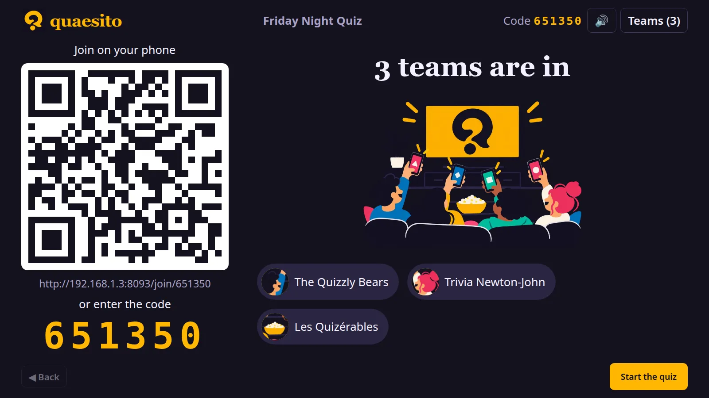
<figcaption>Teams join by scanning the QR code or typing the game code, and pick a name and a picture.</figcaption>
</figure>
<figure markdown>
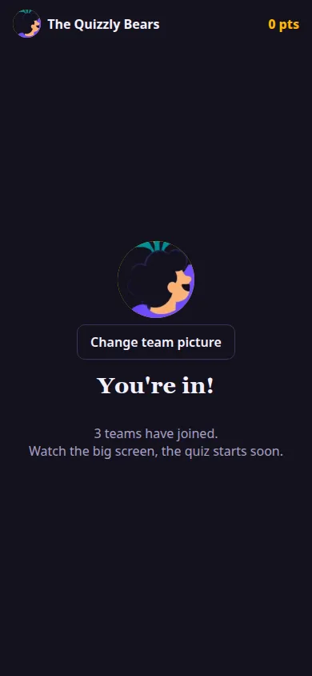
<figcaption>Team leaders play from their phones.</figcaption>
</figure>

<figure markdown>
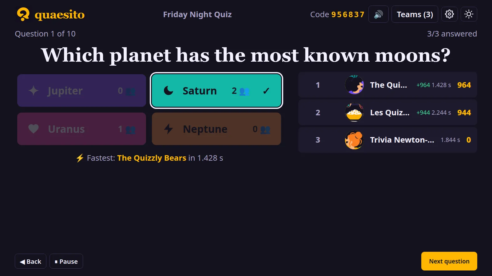
<figcaption>Reveals show the right answer, the fastest team, points gained and who moved up.</figcaption>
</figure>
<figure markdown>
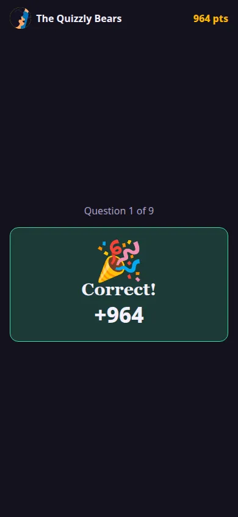
<figcaption>Each team sees its result.</figcaption>
</figure>

## Every kind of question { .section }

-   **Multiple choice:** two to six answers, one or several right, with pictures if you like.
-   **True or false:** quick statements to keep the pace up.
-   **Typed answers:** teams type; you judge on the big screen: full, half or no points, bonus or malus.
-   **Closest number:** how many keys on a piano? The closest guess wins.
-   **Put in order:** oldest first, biggest first; each item in place earns points.
-   **Several answers:** title and artist, or five posters, each part judged on its own.
-   **Pin on a picture:** maps, floor plans, paintings; the closer the pin, the more points.
-   **Slides:** announce rounds and rules between questions.

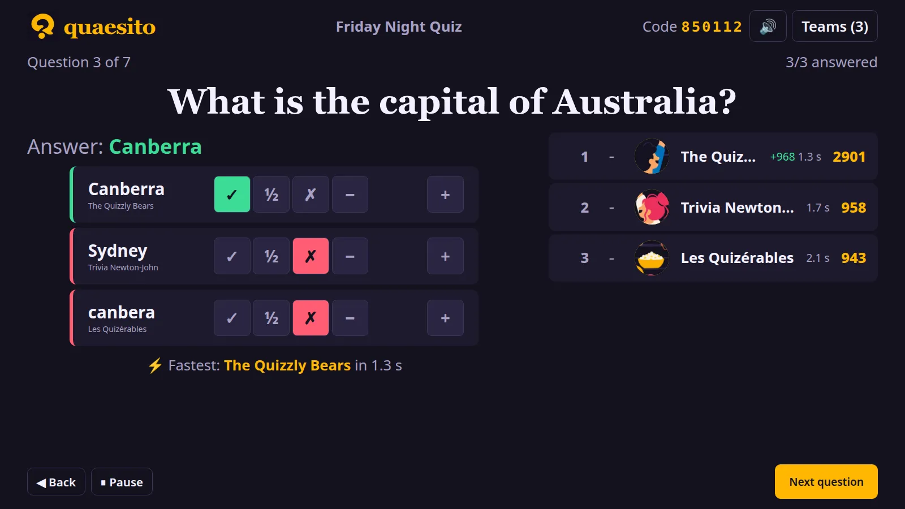

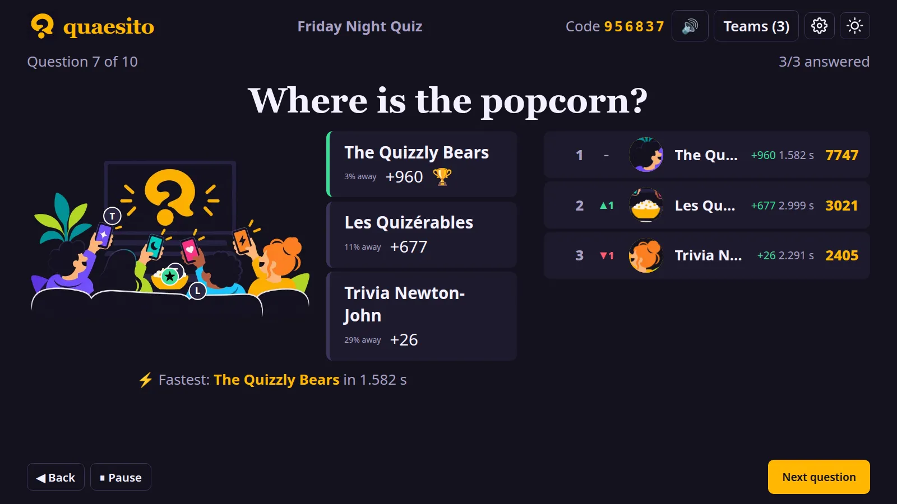

<figure markdown>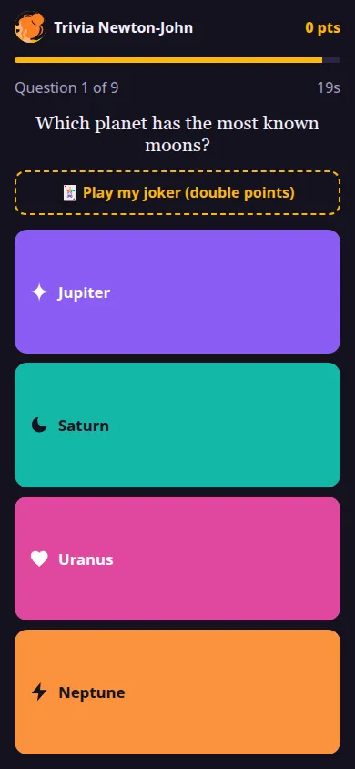<figcaption>Choices</figcaption></figure>
<figure markdown>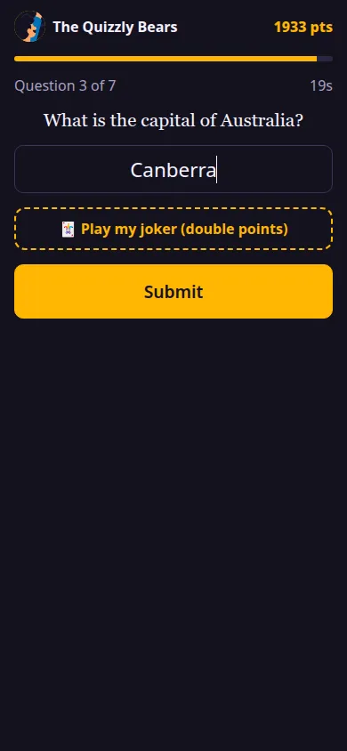<figcaption>Typed answer</figcaption></figure>
<figure markdown>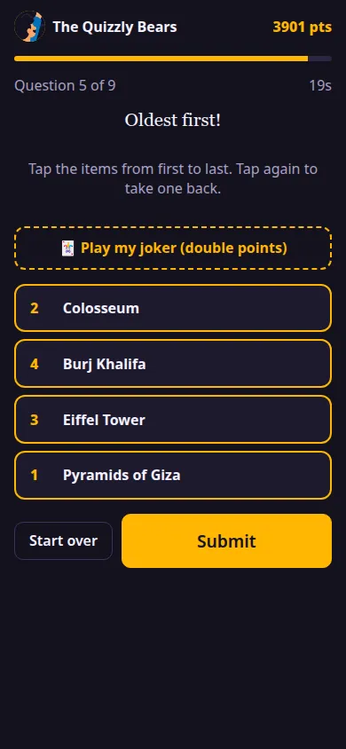<figcaption>Put in order</figcaption></figure>
<figure markdown>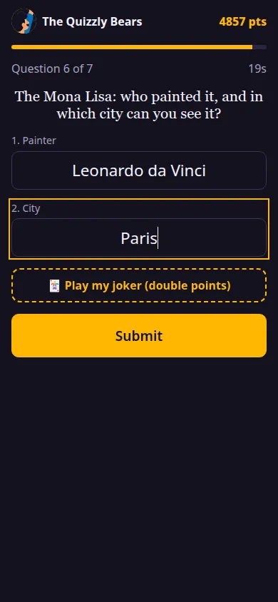<figcaption>Several answers</figcaption></figure>
<figure markdown>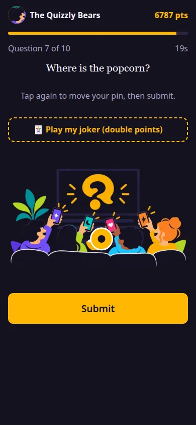<figcaption>Pin on a picture</figcaption></figure>

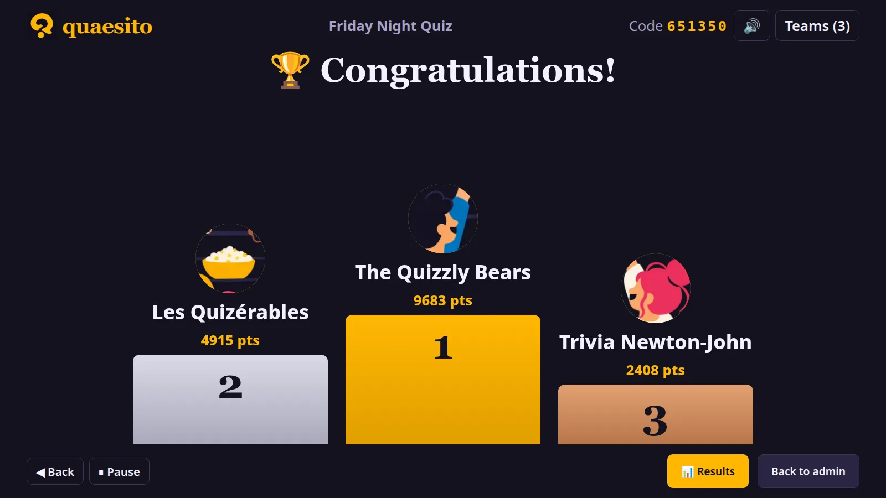

[Download quaesito](https://github.com/ggirelli/quaesito/releases/latest){ .md-button .md-button--primary }
[Read the guide](getting-started.md){ .md-button }
