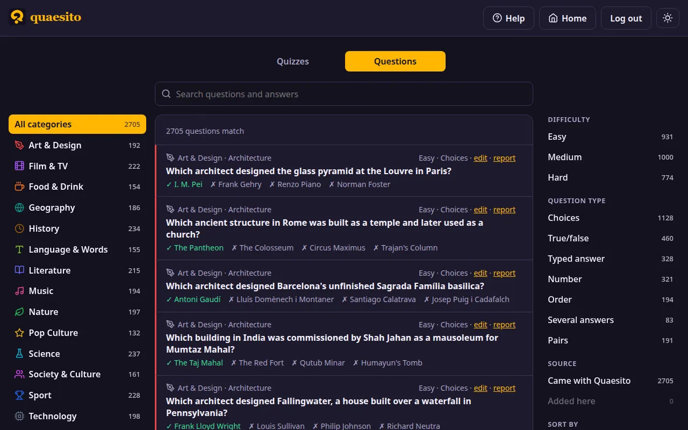

# The question library

Quaesito comes with about 2,700 ready-made questions in 14 categories, from art to technology,
and 99 topics, each rated easy, medium or hard. Use them to fill a quiz in minutes instead of
writing every question yourself, and add questions of your own.



<video controls preload="metadata" poster="../media/demo-library-poster.webp" class="demo-video">
  <source src="../media/demo-library.mp4" type="video/mp4">
  <track kind="captions" src="../media/demo-library.vtt" srclang="en" label="English">
</video>

<small>Browsing the library, filling a quiz at random and saving a question to it, narrated
([transcript](demo.md#the-question-library)).</small>

!!! warning "Read the questions before you play them"
    The questions were written with an AI model, fact-checked and reviewed by hand
    ([how](#how-the-questions-were-made)), but a few may still be wrong. Read the ones you pick before the game.

## Finding and adding questions

- **Browse it** on the admin page's **Questions** tab. Pick a category on the left to see only its
  questions; it opens onto its topics, which narrow the list further. Pick the category again to
  close it. Search questions and answers, filter by difficulty, question type and source (came
  with Quaesito, or added here), and sort by category, difficulty, question type or text.
- **In the editor**, press **＋ From the library** to browse it the same way. **＋ Add** adds one
  question at the end of the quiz; 🎲 **Add at random** adds as many of the questions shown as
  you ask for. Questions already in the quiz are marked, and never added twice at random.
- **For a whole quiz**, tick **Fill it with random questions from the library** when creating it,
  tick the categories you want and say how many questions each gets (5 by default). You can keep
  to one difficulty, and open each category with a title slide.

Once added, a question is yours like any other: edit it, add a picture, or change its time limit
and points. It keeps the category and topic it comes from, which the big screen shows with it.

To write your own questions, see [building a quiz](building-a-quiz.md); to bring in many at once,
write or generate a [quiz file](quiz-file-format.md) and import it.

## Fixing a question

To fix or change a question in the library itself, use its **edit** link: the question opens in a
pop-up like the editor's, with its difficulty. Your changes are kept on this server only and the
question is marked *edited*; **Back to the original** undoes them. Found a question that is plain
wrong? Its **report** link opens a GitHub issue, already filled in with the question and its
answer: just say what is wrong.

## Saving questions to the library

The :material-content-save: button on each question card, between duplicate and delete, keeps a
quiz question and the library in step. On a question of your own, it saves it to the library
(it needs a category and a topic; the pop-up asks for a difficulty, and warns if the library
already has the same question), so other quizzes can use it. Questions saved this way are kept on
this server and marked *added* in the library, where they can be deleted.

A question that came from the library, or was saved to it, stays linked to it, and the button's
colour says how the two compare:

- **In the library**: both are the same.
- **Update library**: you changed it here. The pop-up shows both versions side by side, and says
  how many other quizzes use the question and will be offered the change.
- **Update from library**: the library's question changed since; updating replaces your copy.
- **Changed in both**: pick the version to keep. **Save as new…** saves yours as a separate
  library question instead, and **Unlink** stops comparing them.

A question's own time limit and points, and the order of its choices, are the quiz's: they never
count as changes.

## How the questions were made

1. **Generated** with ChatGPT: 99 batches of 30 questions, one per topic, from the prompt below and
   the [quiz file schema](quiz-file-format.md).
2. **Checked by script** against the schema and the library's rules (see
   [Checking the library](#checking-the-library)).
3. **Fact-checked** by Claude, one reviewer per category, then a second pass trying to refute each
   finding. One question in five had a confirmed problem: duplicates, answers given away by the
   question, ambiguous or wrong answers, poor questions. Typed answers, numbers and several-answer
   questions were the weakest; multiple choice and true/false the best.
4. **Repaired** with ChatGPT, following each finding's fix, and every repair checked again by
   Claude. Questions that could not be fixed, repeats across categories and questions whose answers
   may change over the years were dropped.
5. **Reviewed by hand** by the maintainer, every question.

The batches, findings and repairs are in the project's git history. Mistakes are still possible:
read the questions you pick before playing.

## What the library holds

| Answer type | Questions |
|---|---|
| Multiple choice | 1,128 |
| True or false | 460 |
| Typed answer | 328 |
| Number | 321 |
| Put in order | 194 |
| Pairs | 191 |
| Several answers | 83 |

That is 2,705 questions in all. Library questions have no pictures, sounds, pins or bonus
questions; you can add those once a question is in your quiz.

## Licence

Everything in Quaesito is free under the
[MIT licence](https://github.com/ggirelli/quaesito/blob/main/LICENSE): the software, the
question library, and the pictures that come with the app (the team mascots, the logo). You may
use, change and share the questions, in Quaesito or elsewhere, as long as copies keep the licence's
copyright and permission notice.

## For maintainers

The rest of this page is for those who look after the library in Quaesito's repository.

### Files

Each topic is a file, `library/<category>/<category>-<topic>.json`: a JSON array of entries. The app
combines them when it is built, so a change reaches the app with the next build.

```json
{
  "category": "Science",
  "topic": "Astronomy & space",
  "difficulty": 2,
  "question": { "text": "...", "answers": [{ "text": "...", "correct": true }, { "text": "..." }] }
}
```

- `question` is exactly a question of the [quiz file format](quiz-file-format.md), so it can be
  copied into a quiz as is.
- `difficulty`: 1 most adults know it, 2 keen quizzers, 3 experts.
- Answer types used: multiple choice, true/false, typed answer, number, order, several answers and
  pairs. No pictures, sound, pins or slides, no time limits or bonuses, and no facts that may change
  over the years. A several-answers question is worth ×K points, K being its number of answers;
  every other question is worth ×1.

### Checking the library

```sh
uv run tools/library/check.py           # the whole library; must report 0 errors
uv run tools/library/check.py new.json  # a batch before adding it
just test                               # every question must also be playable
```

`check.py` reports errors (the question cannot be used as is) and warnings (worth a look):

- one right answer among 2–6 options, and no repeated options
- number answers strictly inside their range, with a warning when right in its middle
- order: 2–6 distinct items; pairs: 2–6 distinct items per side; several answers: 2–8 parts
- **no two parts accepting the same answer**: each part is judged on its own, so a team could type
  one answer in every part and score full marks ("name three Axis powers, in any order" is
  rejected)
- the same question twice; near-identical wording is a warning, usually harmless ("What is the
  capital of …")

### Fixing questions from the app

The **edit** link on a library question saves the change on that server only, in the data folder's
`library-edits.json`; questions saved from quizzes go in `library-added.json`. The **report** link
opens a [*Wrong library question*](https://github.com/ggirelli/quaesito/issues/new?template=wrong_question.yml)
issue on GitHub, filled in with the question, its answer and its id. To bring those edits into the library itself, run from the repository:

```sh
just library-apply-edits                          # reads data/library-edits.json
just library-apply-edits path/to/library-edits.json
```

It replaces each edited question (and its difficulty) in its topic file, keeping the file's layout
so `git diff` shows only what changed, then checks the library. Edits the library cannot hold
(pictures, sounds, time limits, bonuses, pin questions) are reported and left out. Running it
again changes nothing.

### Adding questions

Attach `docs/schema/quiz-3.json` to a conversation with an AI model, paste the prompt below and fill
in the batch at the end. Ask for number and typed-answer questions separately if quality matters:
they were the most error-prone. Check the result with `check.py`, fact-check it, then save it as a
topic file (or add its entries to one) and check the library again.

??? note "The prompt used for the default questions"

    ```text
    You are writing trivia questions for Quaesito, a pub-quiz app played on a TV with phones as
    buzzers. The attached JSON Schema (quiz-1.json) defines a question: use its "Question"
    definition exactly, with no other fields.

    OUTPUT
    Return one JSON array, and nothing else, as a downloadable file named <category>-<topic>.json.
    Each element is a library entry:
    {
      "category": "<given below>",
      "topic": "<given below>",
      "difficulty": 1 | 2 | 3,          // 1 = most adults know it, 2 = keen quizzers, 3 = experts
      "question": { ...a Question from quiz-1.json... }
    }

    QUESTION TYPES (use only these; never use Pin or Slide, never set image, audio,
    image_reveal, image_hold_secs, time_limit_secs or bonus; set multiplier only as below)
    - Multiple choice: omit "kind". Exactly 4 "answers", exactly one with "correct": true
      (leave "correct" out of the others). Distractors are plausible, the same kind of
      thing as the right answer, and of similar length. Never "all/none of the above".
    - TrueFalse: "kind": {"TrueFalse": {"answer": true|false}}. "text" is the statement.
      Use both true and false statements, about half each. Avoid statements that are
      true only on a technicality.
    - Typed answer: "kind": {"Text": {"accepted": [...]}}. Answers of 1–3 words. List every
      reasonable spelling: full name, surname only, common abbreviations, with and without
      "The". Only use this type when the answer cannot be mistaken for something else.
    - Number: "kind": {"Number": {"answer": N, "range": {"min": A, "max": B}}}, with
      A < N < B and a range wide enough that N is not obviously in the middle. Years,
      heights, counts, distances. Name the unit in the question text.
    - Order: "kind": {"Order": {"items": [...]}}, 4–6 short items listed in the correct
      order. The question states the order exactly ("earliest first", "largest first"),
      and no two items may be tied. Items must not reveal the order (no years in them).
    - Several answers: "kind": {"Parts": {"parts": [{"label": "...", "accepted": [...]}, ...]}},
      2–5 parts. Each label says what to type ("Title", "Year", "1st", ...), and no two
      parts may accept the same answer. Set "multiplier" to the number of parts.
    - Pairs: "kind": {"Pairs": {"pairs": [{"left": {"text": "..."}, "right": {"text": "..."}}, ...]}},
      4–6 pairs, text only, listed matched, each left item with exactly one possible partner.

    STYLE
    - Question text under 120 characters and read aloud easily; answers under 40 characters.
      Teams read them on small phone screens.
    - One fact per question, unambiguous, with a single defensible right answer.
    - Never put the answer, or another question's answer, in the question text.
    - Prefer interesting over obscure: a "huh, I didn't know that" fact beats a date to recall.
    - No lyrics, long quotes, offensive topics or questions about living private people.
    - "passage" is optional, for a short clue or a quote under 25 words.

    ACCURACY (most important)
    - Use only well-established facts you are confident about. If unsure, drop the question
      rather than guess.
    - Never use facts that may change (records, populations, "current" holders, counts that
      grow, borders and sovereignty in dispute).
    - Before returning, check each entry again: is the marked answer right, and is no other
      answer also right? Fix or remove any that fail.
    - No two entries may ask the same thing, even reworded.

    This batch:
    - category: <e.g. Science>
    - topic: <e.g. Astronomy & space>
    - 30 entries: 12 multiple choice, 5 TrueFalse, 4 typed answer, 4 Number, 2 Order,
      1 Several answers, 2 Pairs
    - difficulty: about 10 each of 1, 2 and 3
    - avoid repeating these existing questions: <paste question texts from the topic, or "none">
    ```
