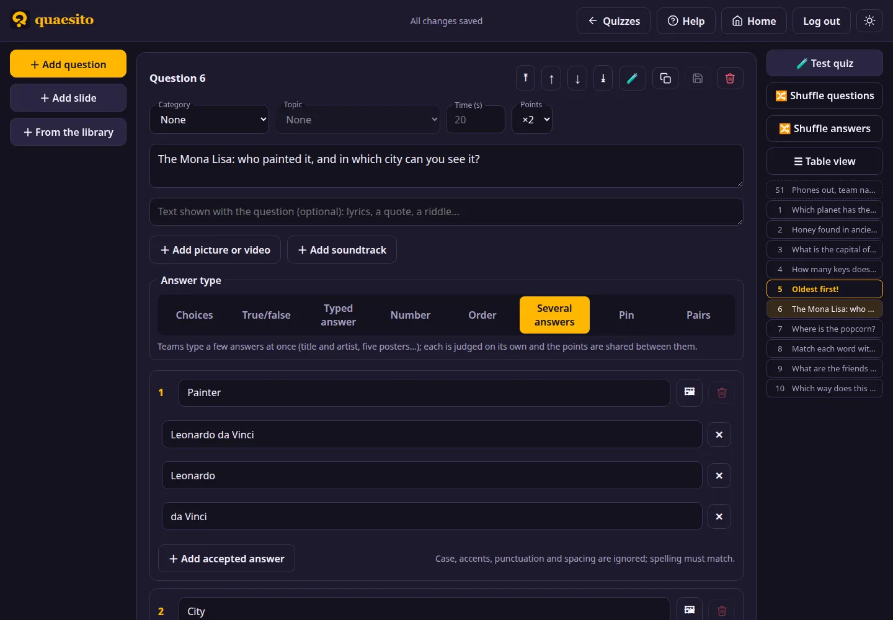
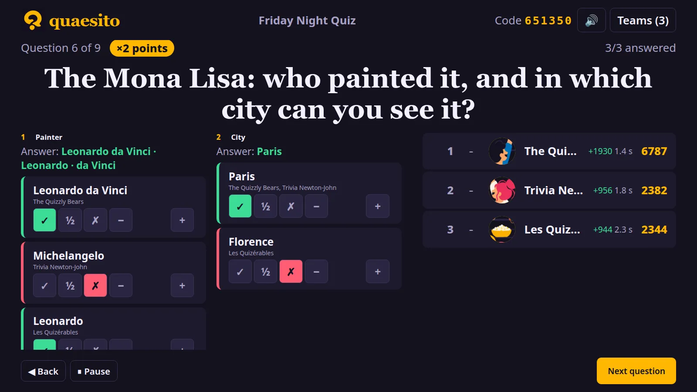
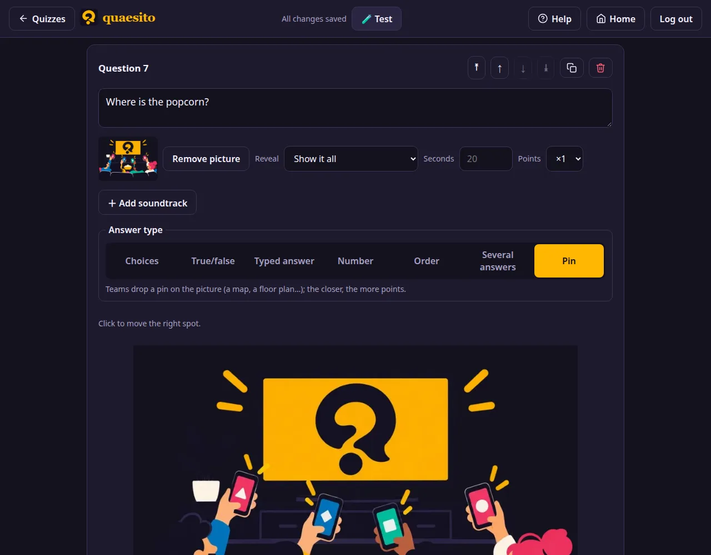

# Question types

| Type | Teams… | Scoring |
|---|---|---|
| Choices | pick one or several of 2–6 answers (text and/or picture) | all or nothing, or partial credit |
| True/false | say whether a statement is true | like choices |
| Typed answer | type a short answer | right when it matches an accepted spelling; you can amend |
| Number | guess a number, with a slider when you set a range | the closest guesses (ties included) win 1000 points |
| Order | tap 2–6 items from first to last | each item in its place earns its share |
| Several answers | type 2–8 answers at once | each part judged like a typed answer; points shared between parts |
| Pin | drop a pin on the question's picture | full points close to the spot, fewer further away |

## Typed answers

Teams' answers are compared with the accepted spellings ignoring case, accents, punctuation and
spacing, but not typos: list the spellings you accept, and amend on the reveal. Identical answers
are grouped, and for each group you choose ✓ full, ½ half or ✗ no points, plus a bonus or malus in
steps of 100. A malus can take a team below zero.

## Number

Type the correct number; the closest guesses win, ties included. Optionally give a **range**
(say 0 to 200): phones then show a slider for a quick guess next to the field for an exact one,
and guesses outside the range are refused. Whole-number ends make the slider move in whole steps.

## Several answers

For the title and the artist of a song, or the titles of five posters: each part has a label,
accepted spellings and, optionally, its own picture (shown in a row on the big screen). Phones
show one field per part; each part is judged on its own, and the question's points are split
evenly between them.

## Pin on a picture

Upload the picture to drop pins on (a map, a floor plan, a painting), click the right spot, and
choose how close pins must be:

| Tolerance | Full points within | No points beyond |
|---|---|---|
| Tight | 2% of the picture's width | 15% |
| Normal | 4% | 30% |
| Loose | 8% | 50% |

In between, points fall evenly with distance. The reveal shows every team's pin and the right
spot.

## Order

List the items in the right order; phones show them shuffled. Teams tap them from first to last
(tap again to take one back), and each item in its right place earns its share of the points.

## Bonus questions

Choices, true/false, number, order and pin questions can carry a **bonus question**: **＋ Add a bonus
question** in the editor, type it (say, "Who sings it?" under "Which band is this?") with its
accepted answers, and choose what it is worth: +25%, +50% or +100% of the points the question can
earn. The big screen shows it under the question, and phones get a bonus field next to the
answers; teams submit both together (with a bonus, a single answer is picked, then submitted).

A right bonus earns its share whether or not the main answer is right. On the reveal, the bonus
answers are grouped and judged like [typed answers](#typed-answers), half points and bonus or
malus included. The question's multiplier and a joker apply to the bonus too.

## Slides

Not questions: a title, text and a picture between questions. Phones show "Eyes on the big
screen" meanwhile.
