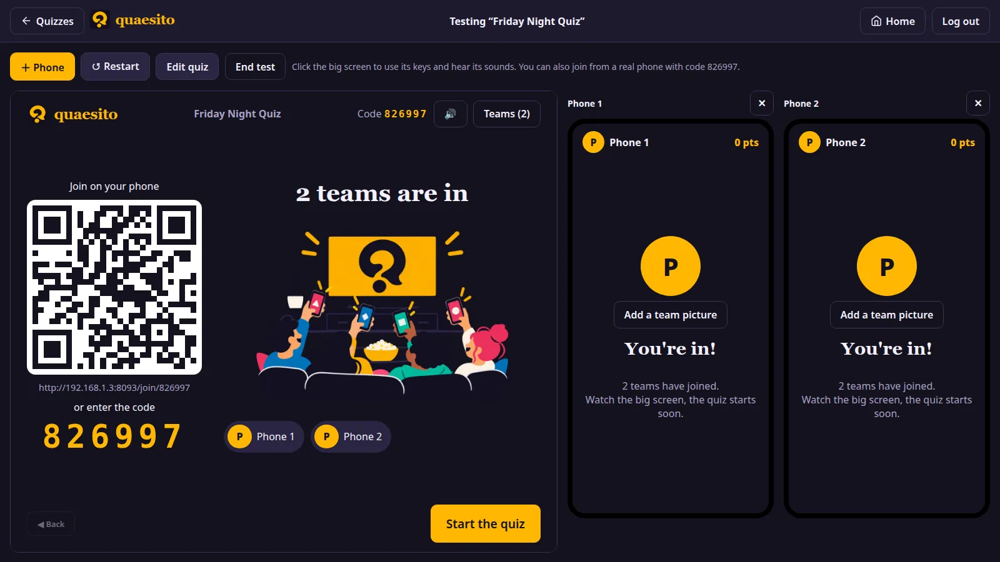

# Testing a quiz

Press **🧪 Test** on the admin page or in the editor (which saves first) to play the quiz on your
own: the real big screen and two phones appear side by side, already joined.

- **＋ Phone** adds a phone (up to six), ✕ removes one.
- **↺ Restart** starts over with a fresh game; **Edit quiz** goes back to the editor; **End test**
  closes it.
- Click the big screen once to use its keyboard shortcuts and hear its sounds.
- The QR code works too: join from a real phone to see the quiz in your hand.

Test games are never saved; one left open shows as "🧪 test" under **Live games**, where you can
end it.
